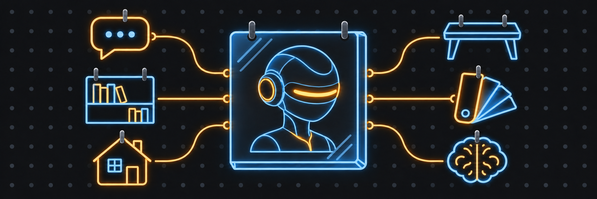

# Hi, I'm Hunter

I make things for myself. Every repo here started as a problem I kept hitting while working with AI, and got built because I was tired of hitting it. If it solves something for you too, grab it and mess around. Change it, break it, make it yours.

**What I actually love is making agents.** Agents with real memory, that wake up tomorrow still knowing you. That's my passion. Everything below exists to make working with an agent like that better. None of it is solved. It's my current best shot, and it changes all the time.

## Start with the glass

It's the closest I've gotten to sitting next to my AI and just pointing. [The glass](https://github.com/HunterBryson/the-glass) is a see-through layer over your screen: box something, say what you want, and your AI answers right beside it, or puts its version next to yours. Ask where a setting hides and it circles it. Once you've had it, the chat window feels like passing notes. (Windows only for now, with Claude Code.)

It's the foundation. Most of my builds are designed to utilize how awesome the glass is, because it's how you and your AI look at the same thing.

## Everything else

- [the bubble](https://github.com/HunterBryson/the-bubble): your AI's face on your screen while it works, so you're not stuck watching the chat.
- [the shelves](https://github.com/HunterBryson/the-shelves): a starter memory any Claude moves into from one pasted line.
- [Homebase](https://github.com/HunterBryson/the-homebase): your AI's memory as a living web you can read, flag and fix.
- [the Den](https://github.com/HunterBryson/the-den): a table you and your AI share, full screen.
- [UI Taste](https://github.com/HunterBryson/ui-taste): box what you like, your AI says what it sees, you say yes or not quite.
- [how Odie remembers](https://github.com/HunterBryson/how-odie-remembers): how we do memory right now, for anyone stuck on the same problem.

Each one sets itself up from one line you paste to your AI. Something broke? Open an issue. Your AI can fill it out for you.

Hunter
